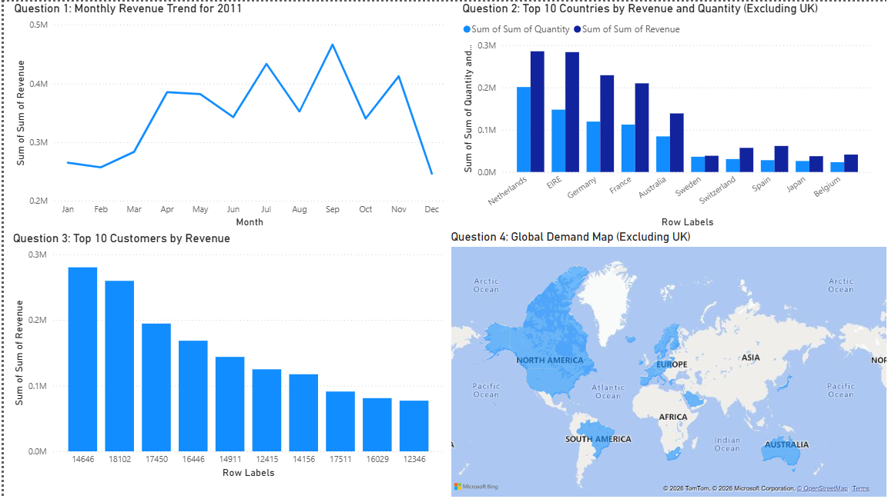

# Retail Sales Performance Dashboard | Tata Forage Virtual Experience

**Tools:** Power BI, Microsoft Excel  
**Domain:** Data Analytics | Business Intelligence | Retail Analytics

## 1. Project Overview

This project was completed as part of the **Tata Data Visualisation: Empowering Business with Effective Insights** virtual experience program on Forage.

The objective was to analyse an online retail store's sales performance and develop meaningful business insights for senior leadership, particularly the CEO and CMO. The analysis focuses on revenue trends, geographical demand, country-level performance and customer revenue contribution to support business growth and expansion decisions.

The project uses the UCI Online Retail dataset, containing **541,909 transaction records**.

## 2. Business Objectives

The analysis was designed to help business leaders:

- Understand monthly revenue trends and seasonality.
- Identify countries generating the highest revenue and sales volume.
- Identify the highest revenue-generating customers.
- Understand geographical demand and potential expansion opportunities.
- Support data-driven strategic and marketing decisions.

## 3. Stakeholder Analysis: Key Business Questions

### CEO – Operations and Business Strategy

1. What are the monthly revenue trends, and which months demonstrate the strongest and weakest performance?
2. Which countries outside the primary market are generating the highest revenue and should be evaluated for expansion?
3. Which products and categories contribute most significantly to total revenue?
4. What is the financial and operational impact of product returns?

### CMO – Marketing and Customer Strategy

1. What is the proportion of repeat customers compared with new customers, and what does it indicate about customer retention?
2. How do purchasing preferences and popular products differ across countries?
3. Who are the most valuable customers based on spending, and where are they geographically located?
4. On which days and at what times is customer purchasing activity highest?

These questions helped establish the business context and guide the analytical approach.

## 4. Data Cleaning and Preparation

The original dataset contained transactions that required validation before analysis.

The following cleaning rules were applied:

- Excluded records where **Quantity was below 1**.
- Excluded records where **Unit Price was below 0**.
- Excluded negative-quantity transactions associated with product returns from the sales analysis.
- Prepared the cleaned data for revenue, country-level and customer-level visualisations.

These checks helped prevent invalid transaction values from distorting the analysis.

## 5. Power BI Dashboard and Visualisations

Four visualisations were developed to address the specific requirements provided during the virtual experience.

### Question 1: Monthly Revenue Trend for 2011

**Visual:** Line Chart

- Displays monthly revenue from January to December 2011.
- Helps identify seasonal patterns and changes in revenue.
- September recorded the highest monthly revenue at approximately 466,343, while December recorded the lowest at approximately 246,257.

**Business relevance:** Helps the CEO understand revenue seasonality and plan future business activities.

### Question 2: Top 10 Countries by Revenue and Quantity (Excluding UK)

**Visual:** Clustered Column Chart

- Identifies the top 10 countries by revenue, excluding the United Kingdom.
- Displays revenue and quantity sold together.
- Highlights countries including the Netherlands, EIRE, Germany, France and Australia.

**Business relevance:** Helps the CMO identify geographically important markets and evaluate potential growth opportunities.

### Question 3: Top 10 Customers by Revenue

**Visual:** Column Chart

- Ranks the top 10 customers based on revenue contribution.
- Arranges customers from highest to lowest revenue.
- Highlights the concentration of revenue among the most valuable customers.

**Business relevance:** Helps the CMO identify high-value customers and develop targeted retention strategies.

### Question 4: Global Demand Map (Excluding UK)

**Visual:** Map Chart

- Presents geographical demand across countries.
- Excludes the United Kingdom.
- Uses geographical highlighting to provide an overview of demand distribution.

**Business relevance:** Helps the CEO identify markets that may warrant further investigation for business expansion.

## 6. Key Business Observations

- Revenue varied considerably across the months of 2011, with September emerging as the strongest month.
- The Netherlands and EIRE were among the leading international revenue-generating countries.
- Customer revenue contribution was concentrated among a relatively small group of high-value customers.
- The global demand map provides a geographical overview that can help identify markets for further evaluation.

Expansion decisions should also consider profitability, logistics, customer retention and operational feasibility before implementation.

## 7. Tools and Technologies

- **Power BI:** Dashboard development and business visualisation.
- **Microsoft Excel:** Dataset review and preparation.
- **Data Analytics:** Revenue analysis, customer analysis and geographical performance analysis.

## 8. Project Deliverables

| Deliverable | File |
|---|---|
| Interactive Power BI dashboard | [Download PBIX](./Tata%20Retail%20Sales%20Performance%20Dashboard.pbix) |
| Dashboard report | [View PDF](./Tata%20Retail%20Sales%20Performance%20Dashboard.pdf) |

## 9. Executive Presentation

A presentation of approximately five minutes was recorded to communicate the data-cleaning process, visualisation choices, business observations and potential expansion opportunities.

The presentation video link will be added here.

## 10. Acknowledgement

This project was completed as part of the **Tata Data Visualisation: Empowering Business with Effective Insights** virtual experience program, hosted on Forage.

**Dataset:** UCI Machine Learning Repository – Online Retail Dataset.
